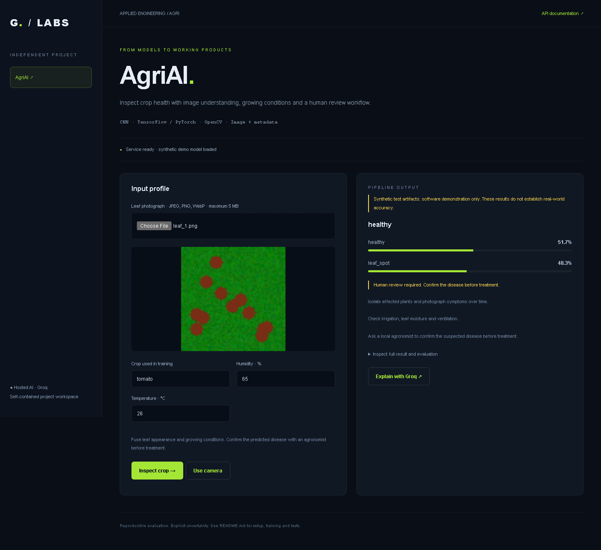
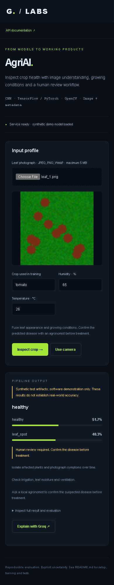

# AgriAI — Intelligent Crop Disease Detection

[](https://github.com/morpheus-3/agriai-crop-disease-detection/actions/workflows/tests.yml)

## Screenshots



<details>
<summary>Mobile view</summary>



</details>


Independent runnable project in `agriai-crop-disease-detection`. Includes a browser UI, REST API, training command, artifact persistence and automated tests. Open the UI at **http://127.0.0.1:8012** and API docs at `/docs`.

## Install and start

Run from this folder (Python 3.10):

```powershell
py -3.10 -m venv .venv
.\.venv\Scripts\python -m pip install -r requirements.txt
$env:GROQ_API_KEY = '<your Groq API key>'
.\.venv\Scripts\python -m uvicorn projects.api:app --host 127.0.0.1 --port 8012
```

Groq is the only hosted AI provider. Optional explanations call its chat completions API, using `GROQ_MODEL` (default `llama-3.3-70b-versatile`). The requested Scikit-learn/TensorFlow/PyTorch models train and run locally; Groq cannot execute arbitrary custom model weights. Missing keys fail explicitly; no other provider is used. The explanation button sends the displayed model result to Groq, not the uploaded image. Set credentials in the server environment, never source code. The UI keeps inputs in page memory.

## Dataset and training


Manifest columns: `path,crop,humidity,temperature,label`. Image paths are relative to the manifest directory; metadata uses % humidity and °C temperature. Supply 20+ images, 2+ classes, and 4+ examples per class. Pre-split by plant/farm/session in real evaluations to avoid near-duplicate leakage; the built-in split is stratified by image label and intended as a baseline.

```powershell
.\.venv\Scripts\python -m projects.train path/to/manifest.csv --epochs 20
# Alternative backend (replaces active AgriAI artifacts):
.\.venv\Scripts\python -m projects.train path/to/manifest.csv --framework pytorch --epochs 20
```

OpenCV decodes and normalizes images; a CNN fuses image features with crop one-hot encoding, humidity and temperature. Both TensorFlow and PyTorch paths are implemented. Reports held-out accuracy and macro-F1. Prediction provides class probabilities and conservative inspection/confirmation steps. It does not prescribe pesticides. Use upload-and-submit for individual frames; the API accepts repeated image frames for camera integrations.


## Test

```powershell
.\.venv\Scripts\python -m pytest tests -q
```

Tests train on deterministic synthetic fixtures, reload artifacts and exercise inference, validation and Groq request contracts. Synthetic metrics establish software execution only, not real predictive quality. Live Groq inference requires a valid key and quota and is not part of automated tests.

## Optional labeled demo data

```powershell
.\.venv\Scripts\python -m projects.fixtures projects/artifacts/fixtures
.\.venv\Scripts\python -m projects.train projects/artifacts/fixtures/agri.csv --epochs 2 --synthetic
```

Restart the service after training. Artifacts live in `projects/artifacts`, or `PROJECT_ARTIFACTS` if configured. Replace synthetic artifacts with models trained on appropriate real data before reporting quality. No real training dataset was supplied.
